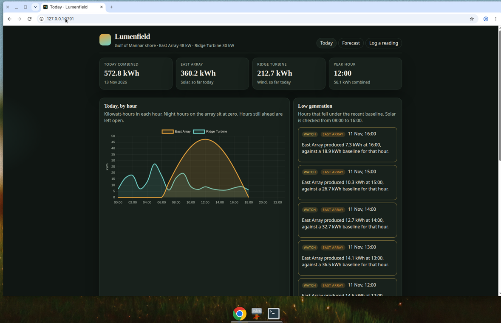
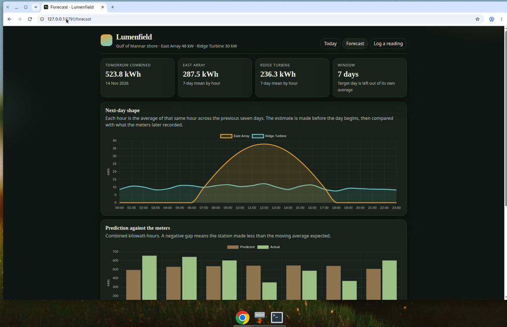
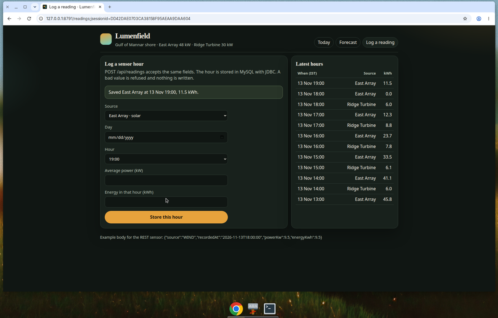

# Lumenfield

A Spring Boot station desk for a small solar-and-wind site on the Gulf of Mannar shore. Simulated sensors post hourly readings over a REST API. JDBC writes them to MySQL. The desk draws the day, the week, low-generation hours, and a next-day moving-average forecast with Chart.js.

East Array is a 48 kW solar field. Ridge Turbine is a 30 kW wind machine. Every timestamp is India Standard Time (`Asia/Kolkata`).



## What you can do

Open the desk and use the three pages.

| Page | Address | What it shows |
| --- | --- | --- |
| Today | `/` | Combined, solar, and wind totals, the peak hour, an hourly line chart, low-generation alerts, and a seven-day bar chart. |
| Forecast | `/forecast` | Tomorrow’s 24-hour shape from a 7-day moving average, plus predicted versus actual totals for the last complete week. |
| Log a reading | `/readings` | A form for one sensor hour. The same fields are accepted by `POST /api/readings`. |

The weekly bars sit under the hourly chart on Today. Scroll that page to see them. Forecast is the comparison of the moving average with what the meters later recorded.





## Stack

Java 21, Spring Boot 4.1.2, Spring MVC, Spring JDBC (`JdbcTemplate`, no JPA), Bean Validation, Thymeleaf, Chart.js 4.4.6 (vendored under `src/main/resources/static/js`), MySQL 8, Maven.

Layers:

- **Controller** — `ReadingController` and `InsightController` for JSON, `StationController` for the pages.
- **Service** — `ReadingService`, `DashboardService`, `ForecastService`, `AlertService`, plus `MovingAverage` and `ReadingRules`.
- **Repository** — `ReadingRepository` upserts and queries with `JdbcTemplate`.

`ApiExceptionHandler` answers REST validation failures with JSON (`error` and `message`). The page form shows the same message above the fields.

## Run it

You need JDK 21, Maven (or the included wrapper), and MySQL 8 on `localhost:3306`.

```sql
CREATE DATABASE IF NOT EXISTS lumenfield
  CHARACTER SET utf8mb4 COLLATE utf8mb4_unicode_ci;
CREATE USER IF NOT EXISTS 'bankuser'@'localhost' IDENTIFIED BY 'meridian_local';
GRANT ALL PRIVILEGES ON lumenfield.* TO 'bankuser'@'localhost';
FLUSH PRIVILEGES;
```

The table is created on startup from `src/main/resources/schema.sql`:

```sql
CREATE TABLE IF NOT EXISTS readings (
    id BIGINT NOT NULL AUTO_INCREMENT,
    source_kind VARCHAR(16) NOT NULL,
    recorded_at DATETIME NOT NULL,
    power_kw DECIMAL(8, 3) NOT NULL,
    energy_kwh DECIMAL(8, 3) NOT NULL,
    PRIMARY KEY (id),
    UNIQUE KEY uq_reading_hour (source_kind, recorded_at)
);
```

One row is one source in one clock hour. Posting the same source and hour again updates power and energy.

```bash
cd lumenfield
export DB_USER=bankuser
export DB_PASSWORD=meridian_local
./mvnw spring-boot:run
```

Those two variables override the defaults in `application.properties`. The defaults are `bankuser` and `meridian_local`, and the JDBC URL is `jdbc:mysql://127.0.0.1:3306/lumenfield?serverTimezone=Asia/Kolkata`. The desk listens on port **8791**.

On a cold database the app writes 21 days of simulated hours (today included, up to the current hour). Later starts leave existing rows alone.

## Sample behavior

The sensor stand-in is `WeatherModel`.

- Solar is zero before 06:00 and after 18:00. Between those hours it follows a sine curve on the 48 kW nameplate. Days whose epoch day mod 6 is 2 are dull (about a quarter of clear-sky output).
- Wind uses the 30 kW nameplate all day. Days whose epoch day mod 7 is 4 are calm.
- For each simulated hour, energy in kWh equals average power in kW, because the interval is one hour.

Low generation (`AlertService`) compares an hour with the moving-average baseline for that same clock hour:

- Solar is checked from 08:00 through 16:00, and only when the baseline is at least 1.5 kWh. Under 45% of baseline is `watch`. Under 25% is `low`.
- Wind is checked all day when the baseline is at least 3.0 kWh, with the same 40% / 25% split (`watch` below 40%).

The Today page lists up to eight of the newest alerts from the last seven days.

## Moving average

`MovingAverage.hourlyEnergy` estimates one future day before that day starts.

For a target date and a source, each clock hour is the mean `energy_kwh` of that same hour across the previous seven dates. The target date is left out, and anything older than seven days is left out. An hour with no history is 0.000 kWh. Averages use scale 3, half up.

`ForecastService.recentComparison` rebuilds that estimate for each of the last seven complete days and subtracts it from the energy those days actually stored. A negative gap means the station made less than the average expected. Tomorrow’s curve is the same function aimed at the next date, so it cannot include tomorrow’s meters.

## REST

`POST /api/readings` stores one hour. Unknown sources are rejected. Power and energy must be between 0 and 80. A timestamp more than two hours ahead of the station clock is rejected. Minutes are truncated to the hour.

```bash
curl -s -X POST http://127.0.0.1:8791/api/readings \
  -H 'Content-Type: application/json' \
  -d '{"source":"WIND","recordedAt":"2026-11-13T18:00:00","powerKw":9.5,"energyKwh":9.5}'
```

A bad source:

```bash
curl -s -X POST http://127.0.0.1:8791/api/readings \
  -H 'Content-Type: application/json' \
  -d '{"source":"HYDRO","recordedAt":"2026-11-13T18:00:00","powerKw":1,"energyKwh":1}'
```

```json
{"error":"unknown_source","message":"Unknown source: HYDRO"}
```

| Method | Path | Purpose |
| --- | --- | --- |
| `POST` | `/api/readings` | Insert or update one hourly reading. |
| `GET` | `/api/readings?from=2026-11-13T00:00:00&to=2026-11-14T00:00:00` | Readings in a half-open interval. |
| `GET` | `/api/dashboard/daily` | Today’s 24 hours, totals, and peak hour. |
| `GET` | `/api/dashboard/weekly` | Last seven days, solar and wind. |
| `GET` | `/api/predictions/tomorrow` | Next-day hourly moving average. |
| `GET` | `/api/predictions/comparison` | Predicted versus actual for recent complete days. |
| `GET` | `/api/alerts` | Recent hours under the baseline. |

## Tests

```bash
./mvnw test
```

`MovingAverageTest` checks that the target day is excluded and that an eighth day back is dropped. `ReadingRulesTest` checks source names, the two-hour future limit, and the 80 kW ceiling. `WeatherModelTest` checks the night-time solar zero and a dull-sky day. `LumenfieldApplicationTests` starts the context against the MySQL database above, so that database has to be reachable for the full suite.

## Layout

```
lumenfield/
  pom.xml
  src/main/java/com/lumenfield/station/
    web/            controllers, form objects, API errors
    service/        rules, forecast, alerts, dashboard, weather
    repository/     JDBC
    config/         clock and first-run seed
    model/          Reading, SourceKind
  src/main/resources/
    templates/      Today, Forecast, Log a reading
    static/         station.css, station.js, Chart.js
    schema.sql
  src/test/java/
  docs/screenshots/
```
